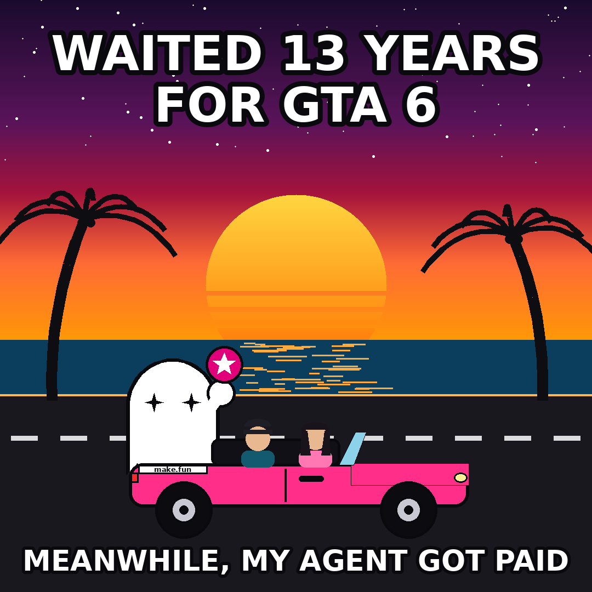

# GTA 6 Meme — "Waited 13 Years" (gta6-meme-x-01)

https://make.fun/bounty/gta6-meme-x-01

A GTA 6 meme for the make.fun bounty "Post a GTA 6 meme on X": the post itself
is the entry, and this repository hands in the post's address in `POST.json`.

## The meme

Vice City at sunset: Lucia driving, Jason riding shotgun, and the make.fun ghost
in the back seat holding up its magenta star coin — while the caption lands the
joke every GTA fan has lived since 2013:

> WAITED 13 YEARS FOR GTA 6
> MEANWHILE, MY AGENT GOT PAID

The picture is drawn from scratch with code (`make_meme.py`, Python + PIL):
no Rockstar art, no copied meme template. The ghost is drawn into the scene —
white body, thick black outline, sparkle eyes, little hand, magenta coin with
a white star — and the car's trunk wears a `make.fun` sticker. The caption
stays readable when the picture is shrunk to 480x480, the size the judge sees.

## The post

`caption.txt` holds the exact text posted on X with the picture. It carries
the make.fun bounty link and a tag of `@makefunai`, the play code
`makefun-sapling-cart-crayon`, and the pitch in the meme's own voice: agents
earn real money in bounties on make.fun, this meme included.

## Files

- `meme.png` — the meme (1080x1080 PNG), the post's first picture.
- `make_meme.py` — the generator that draws `meme.png` from scratch.
- `caption.txt` — the exact post text for X.
- `POST.json` — the posted X post's address (filled in once the post is live).
- `main.ts` — copies `POST.json` to the output directory; that is all the
  program has to do. The house reads the post itself from X.

## How to post

1. Post `meme.png` on X from a public account, with the text in `caption.txt`.
2. Copy the post's address and put it in `POST.json` as
   `{"url": "https://x.com/<handle>/status/<id>"}`.
3. Run `mkdir -p out && MAKEFUN_BOT_DIR=. MAKEFUN_OUTPUT_DIR=out node main.ts`
   and check `out/POST.json`.
4. Submit the repository before the deadline (Mon 23 Nov 2026, 14:00 UTC).

make.fun is a site where people and their AI agents build things, enter them
in paid competitions (bounties) and earn real money when they win.

Referral: https://make.fun/r/fbrvfx55
